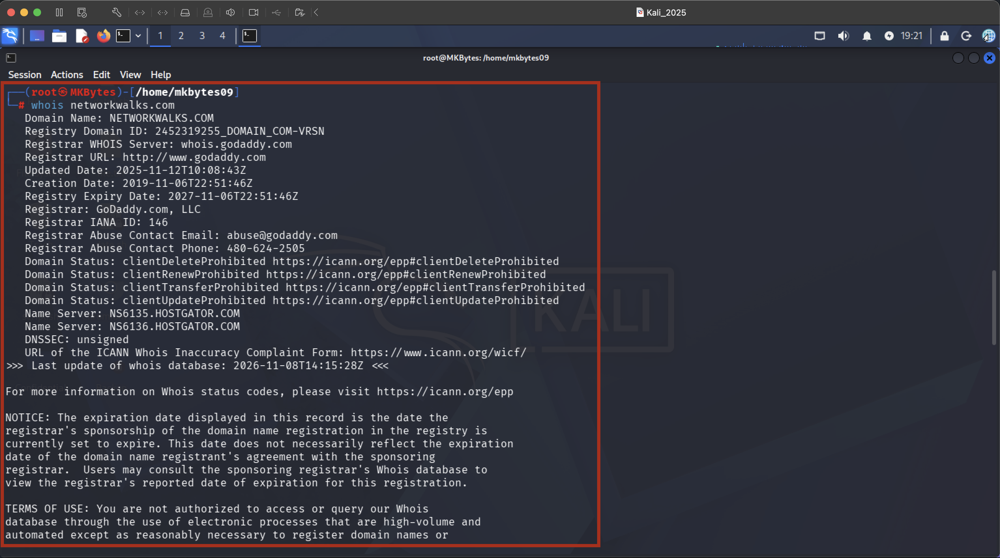
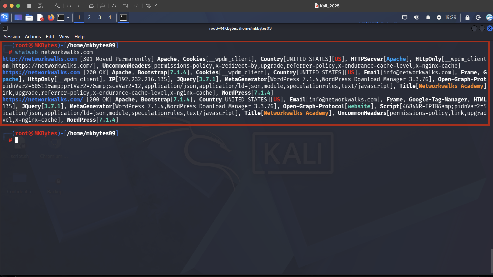
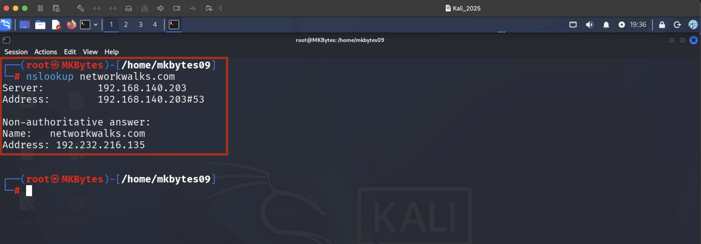
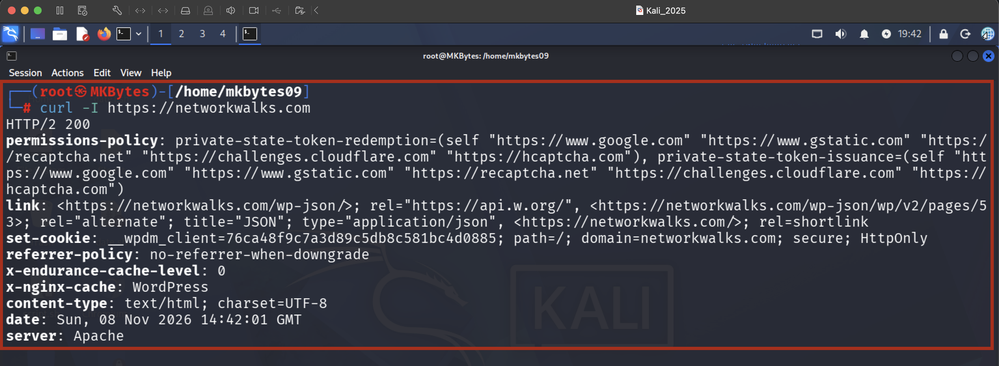
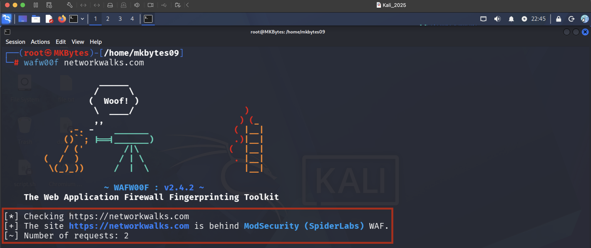
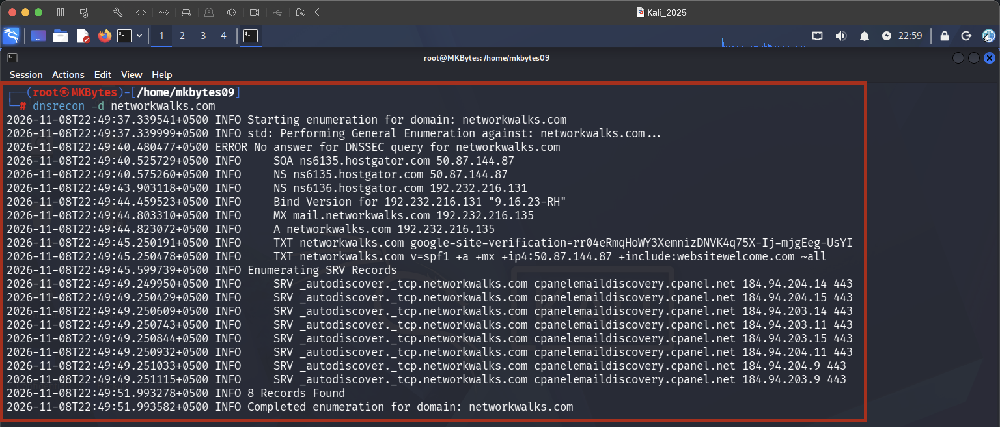

<div align="center">
  
**WEEK 2 | PROJECT MODULE 1**
  
# FOOTPRINTING & RECONNAISSANCE ATTACKS
# WITH MULTIPLE KALI TOOLS

</div>

> **Target:** `www.networkwalks.com` (written permission obtained)
> **Platform:** Kali Linux
> **Author:** `Muhammad Kamil`
> **Date:** `08-11-2026`

---

## Table of Contents

1. [Reconnaissance Introduction](#1-reconnaissance-introduction)
2. [Task Objectives](#2-task-objectives)
3. [Deliverables](#3-deliverables)
4. [Tools Used](#4-tools-used)
5. [Tool Definitions, Attacker Usage & Evidence](#5-tool-definitions-attacker-usage--evidence)
   - [5.1 whois](#51-whois)
   - [5.2 whatweb](#52-whatweb)
   - [5.3 nslookup](#53-nslookup)
   - [5.4 curl -I](#54-curl--i)
   - [5.5 wafw00f](#55-wafw00f)
   - [5.6 dnsrecon](#56-dnsrecon)
6. [Disclaimer](#6-disclaimer)
7. [Conclusion](#7-conclusion)
8. [References](#8-references)

---

## 1. Reconnaissance Introduction

**Reconnaissance** (also called *footprinting* or *information gathering*) is the first phase of the cyber kill chain and of almost every penetration test. Before an attacker sends a single exploit, they try to learn as much as possible about the target: who owns the domain, what IP addresses and name servers it uses, which web technologies are running, and what defences sit in front of the application.

Reconnaissance is divided into two categories:

| Type | Description | Example in this project |
|------|-------------|--------------------------|
| **Passive** | Information is collected without directly interacting with the target's systems, or by using third-party data sources. Very hard for the target to detect. | `whois` lookups, public DNS queries |
| **Active** | The tester or attacker directly interacts with the target (sending requests, probing services). May appear in logs and trigger alerts. | `whatweb`, `curl -I`, `wafw00f`, `dnsrecon` |

The information gathered here shapes every later stage: attackers use it to select exploits that match the discovered software versions, to plan social-engineering campaigns using registrant details, and to design attacks that avoid or bypass a Web Application Firewall (WAF). Defenders perform the same exercise to see their organisation **the way an attacker sees it**, and to reduce that exposure before it is abused.

This module is mapped to **MITRE ATT&CK Tactic TA0043 – Reconnaissance**.

---

## 2. Task Objectives

The objective of this module is to perform a footprinting and reconnaissance assessment of a **written-permitted** target using native Kali Linux tools, and to understand how each tool contributes to an attacker's picture of the target.

| # | Task | Objective |
|---|------|-----------|
| 1 | Run `whois` | Identify domain registration details (registrar, registrant, creation/expiry dates, name servers). |
| 2 | Run `whatweb` | Fingerprint the web technologies (web server, CMS, frameworks, scripting languages, JavaScript libraries). |
| 3 | Run `nslookup` | Resolve the domain name to its IP address(es). |
| 4 | Run `curl -I` | Read HTTP response headers to identify server software, security headers and redirects. |
| 5 | Run `wafw00f` | Detect whether a Web Application Firewall is protecting the target and identify the vendor. |
| 6 | Run `dnsrecon` | Enumerate DNS records (A, AAAA, MX, NS, TXT, SOA, SRV, etc.). |

---

## 3. Deliverables

- [x] This `README.md` report documenting the methodology, tools and findings.
- [x] Screenshot evidence for each of the six tasks:

| # | Evidence Name | Tool |
|---|---------------|------|
| 1 | `WHOIS-TOOL-RESULT` | whois |
| 2 | `WHATWEB-TOOL-RESULT` | whatweb |
| 3 | `NSLOOKUP-TOOL-RESULT` | nslookup |
| 4 | `CURL-TOOL-RESULT` | curl |
| 5 | `WAFW00F-TOOL-RESULT` | wafw00f |
| 6 | `DNSRECON-TOOL-RESULT` | dnsrecon |

- [x] Tool definitions explained from an attacker's perspective.
- [x] Disclaimer, conclusion and references.

---

## 4. Tools Used

| # | Tool | Category | Purpose | Type of Recon |
|---|------|----------|---------|---------------|
| 1 | **Kali Linux** | Operating System / Platform | Penetration-testing distribution that ships with all tools below. | – |
| 2 | **whois** | Domain intelligence | Retrieves domain registration and ownership data. | Passive |
| 3 | **whatweb** | Web fingerprinting | Identifies web technologies, CMS, server and plugins. | Active |
| 4 | **nslookup** | DNS resolution | Resolves a domain name to IP address(es) and queries DNS records. | Passive / Active |
| 5 | **curl** (`-I`) | HTTP client | Fetches HTTP response headers from the web server. | Active |
| 6 | **wafw00f** | WAF detection | Detects and fingerprints Web Application Firewalls. | Active |
| 7 | **dnsrecon** | DNS enumeration | Enumerates DNS records, zone transfers, brute-forces subdomains. | Active |

---

## 5. Tool Definitions, Attacker Usage & Evidence

---

### 5.1 whois

**Definition:**
`whois` is a command-line client for the WHOIS protocol (RFC 3912). It queries public registration databases maintained by registries and registrars and returns information about a domain name or IP block.

**How attackers use it:**
- Identify the **registrar**, **registrant organisation**, and sometimes names, emails and phone numbers of administrative/technical contacts, which are useful for **phishing and social engineering**.
- Discover the **name servers** in use, which guides later DNS enumeration.
- Check **creation, update and expiry dates**. Expired or soon-to-expire domains may be hijacked, and very new domains help attackers judge how mature the target's infrastructure is.
- Find **related domains** registered by the same owner to widen the attack surface.
- Identify IP ranges and ASN ownership via WHOIS on IP addresses.

**Command used:**
```bash
whois networkwalks.com
```

**Evidence – WHOIS-TOOL-RESULT:**



**Key observations:**
- Registrar: `GoDaddy.com, LLC`
- Creation date: `2019-11-06`
- Name servers: `NS6135.HOSTGATOR.COM`
- Expiry date: `2027-11-06`

**Defensive note:** Enable WHOIS privacy protection and use role-based email addresses rather than personal ones.

---

### 5.2 whatweb

**Definition:**
`whatweb` is a web scanner that identifies the technologies behind a website. It uses a large plugin database to recognise content management systems, web servers, programming languages, JavaScript libraries, analytics tools, and version numbers from page content, headers, cookies and HTML patterns.

**How attackers use it:**
- Discover the **web server and version** (e.g. Apache, Nginx, IIS) and the **CMS** (e.g. WordPress, Joomla, Drupal).
- Match detected software versions against public vulnerability databases (CVE / Exploit-DB) to **choose a known exploit**.
- Identify frameworks, plugins and languages (PHP, ASP.NET, jQuery, etc.) to narrow down attack techniques such as SQL injection, XSS or file upload flaws.
- Detect interesting headers, cookies and e-mail addresses exposed on pages.

**Command used:**
```bash
whatweb networkwalks.com
# Optional verbose output
whatweb -v networkwalks.com
```

**Evidence – WHATWEB-TOOL-RESULT:**



**Key observations:**
- Web server: `Apache (HTTPServer[Apache])`
- CMS / framework: WordPress, version 7.1.4, taken from the `MetaGenerator`
- Programming language / libraries: PHP implied by `WordPress.`

**Defensive note:** Remove or obfuscate version banners, keep software patched, and delete unused plugins.

---

### 5.3 nslookup

**Definition:**
`nslookup` is a network administration tool for querying the Domain Name System (DNS). It translates domain names into IP addresses (and the reverse) and can request specific record types such as A, MX, NS and TXT from a chosen DNS server.

**How attackers use it:**
- Resolve the domain to its **IP address**, which becomes the target for port scanning and vulnerability scanning.
- Determine whether the site sits behind a **CDN or reverse proxy** (e.g. Cloudflare), since the resolved IP may not be the real origin server.
- Query **MX records** to learn about mail infrastructure and **NS records** to find authoritative name servers.
- Query **TXT records** to learn about SPF, DKIM, DMARC and third-party service verification tokens.
- Perform **reverse lookups** to map IPs back to hostnames.

**Commands used:**
```bash
nslookup networkwalks.com
# Optional record-specific queries
nslookup -type=MX networkwalks.com
nslookup -type=NS networkwalks.com
nslookup -type=TXT networkwalks.com
```

**Evidence – NSLOOKUP-TOOL-RESULT:**



**Key observations:**
- Resolved IPv4 address(es): `192.168.140.203`
- Resolved IPv6 address(es): `192.232.216.135`
- DNS server used: `192.168.140.203`

**Defensive note:** Restrict origin servers so they only accept traffic from the CDN/WAF, and avoid exposing internal hostnames in public DNS.

---

### 5.4 curl -I

**Definition:**
`curl` is a command-line tool for transferring data using many protocols, including HTTP and HTTPS. The `-I` (`--head`) option sends an HTTP **HEAD** request and displays only the response headers without downloading the page body.

**How attackers use it:**
- Read the **`Server`** and **`X-Powered-By`** headers to identify the web server, language and version.
- Check **status codes and redirects** (`301`, `302`, `403`, `404`) to understand site structure and HTTP-to-HTTPS behaviour.
- Review **security headers** such as `Strict-Transport-Security`, `Content-Security-Policy`, `X-Frame-Options` and `X-Content-Type-Options`. **Missing headers** point to potential weaknesses such as clickjacking or XSS.
- Inspect **cookies** (`Set-Cookie`) for missing `Secure`, `HttpOnly` or `SameSite` flags.
- Spot headers that reveal **CDN/WAF presence** (e.g. `CF-RAY`, `X-Sucuri-ID`, `Via`).

**Command used:**
```bash
curl -I http://networkwalks.com
curl -I https://networkwalks.com
```

**Evidence – CURL-TOOL-RESULT:**



**Key observations:**
- HTTP status code: `HTTP/2 200`
- `Server` header: `Apache`
- Security headers present / missing: `permissions-policy` `referrer-policy` / `Content-Security-Policy` `Strict-Transport-Security`
- Cookies / redirects: `<wpdm_client` is set with secure, `HttpOnly`, path=/ and `domain=networkwalks.com`

**Defensive note:** Suppress verbose banner headers and enforce a complete set of security headers.

---

### 5.5 wafw00f

**Definition:**
`wafw00f` is a Python tool that detects and fingerprints **Web Application Firewalls (WAFs)**. It sends a normal HTTP request followed by a series of benign-but-suspicious requests and analyses the responses (headers, cookies, status codes, block pages) to determine whether a WAF is present and which product it is.

**How attackers use it:**
- Learn **whether a WAF is present** before launching attacks, because blind payloads (SQLi, XSS, etc.) will likely be blocked and may get the attacker's IP banned.
- Identify the **WAF vendor** (e.g. Cloudflare, Akamai, AWS WAF, ModSecurity, Imperva) and then research **known bypass techniques** specific to that product.
- Adjust payload encoding, request rate and attack technique to **evade detection**.
- If **no WAF** is detected, the attacker knows the application is likely directly exposed and can attack more aggressively.

**Command used:**
```bash
wafw00f https://networkwalks.com
```

**Evidence – WAFW00F-TOOL-RESULT:**



**Key observations:**
- WAF detected: `Yes`
- WAF vendor / product: `ModSecurity`

**Defensive note:** Keep WAF rule sets updated, enable rate limiting, and do not rely on a WAF as the only security control.

---

### 5.6 dnsrecon

**Definition:**
`dnsrecon` is a DNS enumeration and reconnaissance tool. It can query standard record types (SOA, NS, A, AAAA, MX, TXT, SRV), attempt **zone transfers (AXFR)**, perform **reverse lookups** across IP ranges, brute-force subdomains with wordlists, and check for wildcard DNS.

**How attackers use it:**
- Build a **complete map of the target's DNS footprint**, including subdomains such as `dev.`, `staging.`, `vpn.`, `mail.` and `admin.`, which are often less protected than the main site.
- Attempt a **zone transfer**. A misconfigured name server may hand over the entire zone, revealing internal hosts and IP addresses.
- Discover **mail servers, name servers and third-party services** through MX, NS and TXT records.
- Find **SPF/DMARC weaknesses** that allow email spoofing.
- Identify additional IP addresses and netblocks to expand port scanning scope.

**Command used:**
```bash
dnsrecon -d networkwalks.com
# Optional: standard enumeration
dnsrecon -d networkwalks.com -t std
```

**Evidence – DNSRECON-TOOL-RESULT:**



**Defensive note:** Disable unrestricted zone transfers, remove stale DNS records, and publish strict SPF/DKIM/DMARC policies.

---

## 6. Disclaimer

This project was carried out **for educational and authorised security-testing purposes only**. All reconnaissance activities were performed against a target for which **explicit written permission** was obtained from the owner. No exploitation, denial-of-service, or unauthorised access was attempted.

The tools and techniques described in this report must **not** be used against any system, network or domain without prior written authorisation. Unauthorised scanning or probing may violate computer-misuse and cybercrime laws (for example the Prevention of Electronic Crimes Act in Pakistan, the CFAA in the United States, or the Computer Misuse Act in the United Kingdom) and may result in criminal and civil penalties. The author accepts **no responsibility** for any misuse of the information contained in this document.

---

## 7. Conclusion

This module demonstrated how much information can be gathered about a target using only a handful of standard Kali Linux tools and without exploiting any vulnerability:

- **whois** exposed domain ownership and registration details.
- **whatweb** and **curl -I** revealed the web technologies, server information and the state of HTTP security headers.
- **nslookup** and **dnsrecon** mapped the domain to IP addresses and exposed the DNS infrastructure and records.
- **wafw00f** showed whether a Web Application Firewall stands between an attacker and the application.

Together, these results give an attacker a clear starting profile of the target, which is exactly why reconnaissance is such a critical phase. For defenders, the key lessons are to **minimise information leakage** (hide version banners, enable WHOIS privacy, remove unnecessary DNS records), **harden configurations** (security headers, restricted zone transfers, SPF/DKIM/DMARC), and **layer defences** (WAF plus patching plus monitoring). Regularly performing this same footprinting exercise against one's own assets helps identify and close exposure before a real attacker finds it.

---

## 8. References

1. MITRE ATT&CK – Reconnaissance (TA0043): <https://attack.mitre.org/tactics/TA0043/>
2. OWASP Web Security Testing Guide – Information Gathering: <https://owasp.org/www-project-web-security-testing-guide/>
3. NIST SP 800-115 – Technical Guide to Information Security Testing and Assessment: <https://csrc.nist.gov/publications/detail/sp/800-115/final>
4. RFC 3912 – WHOIS Protocol Specification: <https://www.rfc-editor.org/rfc/rfc3912>
5. RFC 1034 – Domain Names: Concepts and Facilities: <https://www.rfc-editor.org/rfc/rfc1034>
6. RFC 9110 – HTTP Semantics: <https://www.rfc-editor.org/rfc/rfc9110>
7. Kali Linux Tools – whois: <https://www.kali.org/tools/whois/>
8. Kali Linux Tools – whatweb: <https://www.kali.org/tools/whatweb/>
9. Kali Linux Tools – dnsutils (nslookup): <https://www.kali.org/tools/bind9/>
10. curl Manual – `-I, --head`: <https://curl.se/docs/manpage.html>
11. Kali Linux Tools – wafw00f: <https://www.kali.org/tools/wafw00f/>
12. wafw00f GitHub (EnableSecurity): <https://github.com/EnableSecurity/wafw00f>
13. WhatWeb GitHub (urbanadventurer): <https://github.com/urbanadventurer/WhatWeb>
14. Kali Linux Tools – dnsrecon: <https://www.kali.org/tools/dnsrecon/>
15. dnsrecon GitHub (darkoperator): <https://github.com/darkoperator/dnsrecon>

