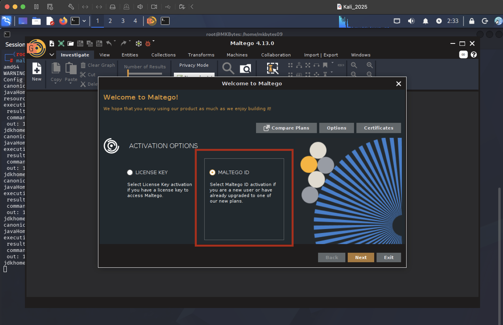
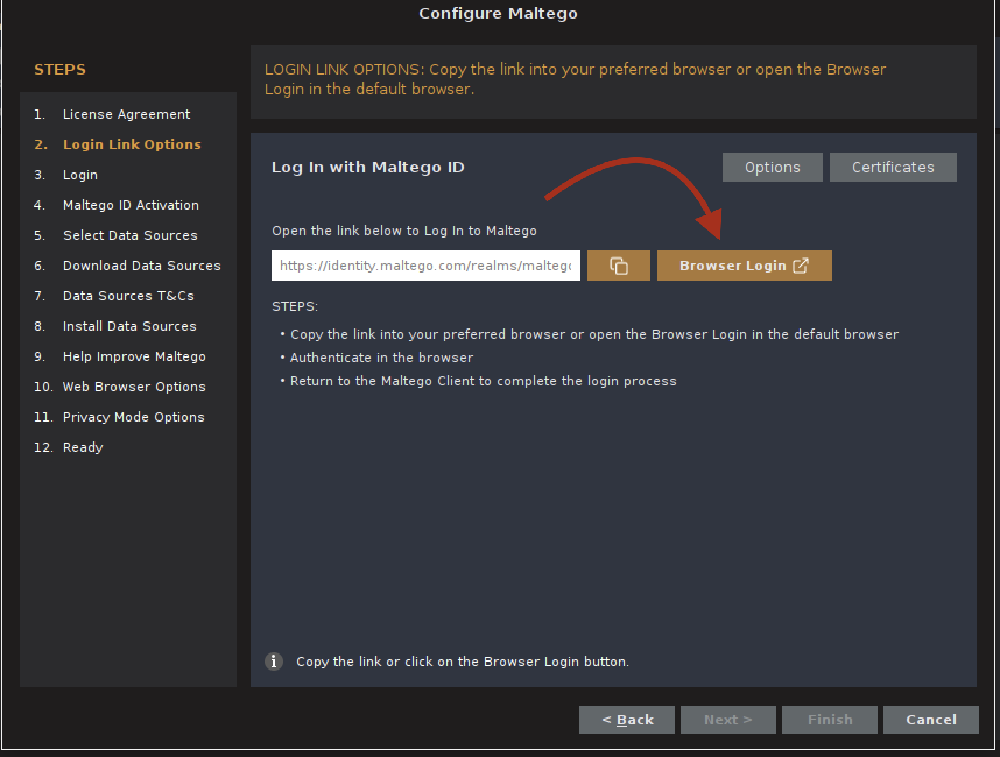
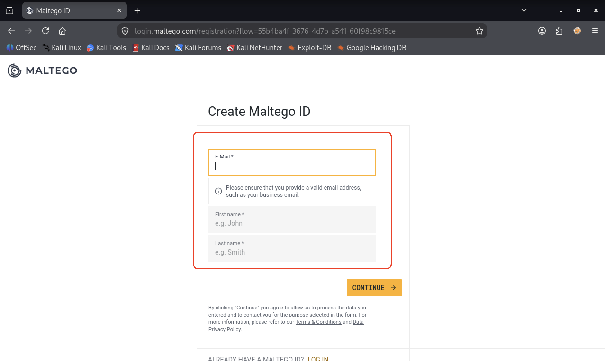
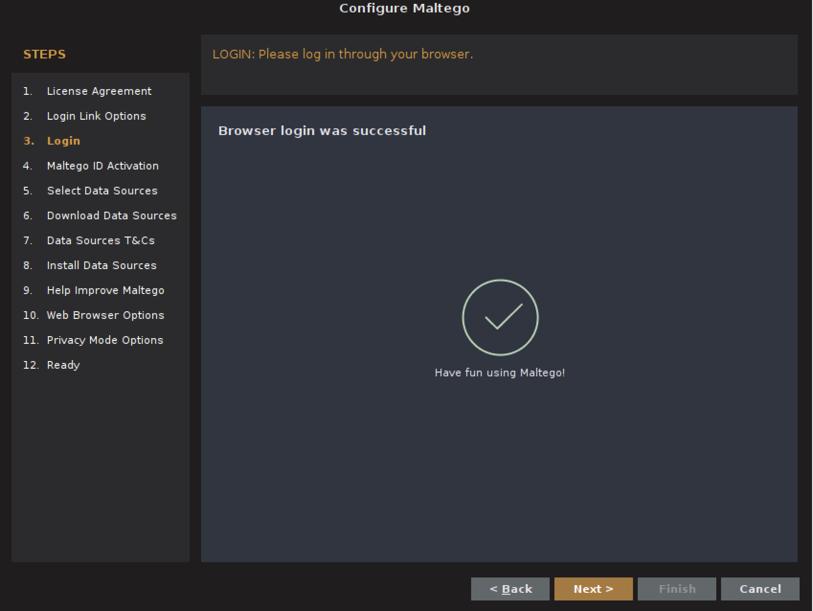
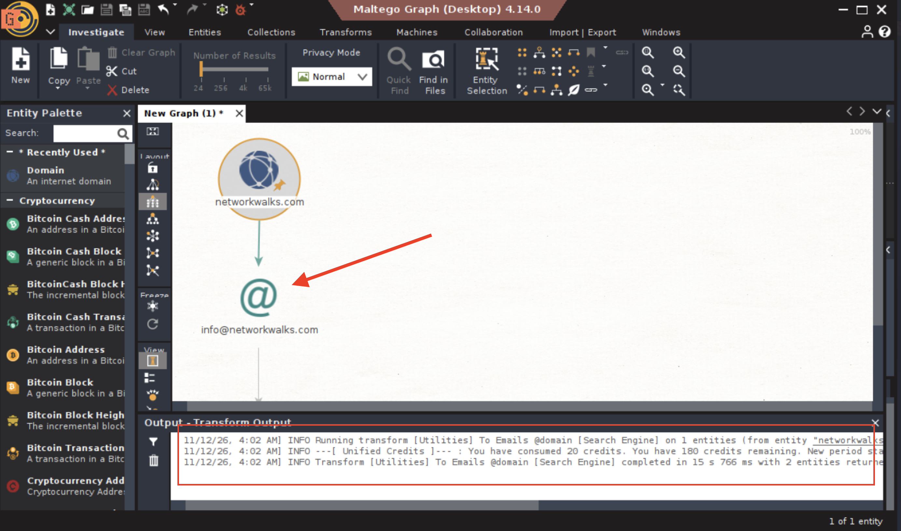

  
**WEEK 2 | PROJECT MODULE 3**
  
# FOOTPRINTING & EMAIL HARVESTING
# WITH MALTEGO IN KALI LINUX

> **Target:** `networkwalks.com` (written permission obtained)
> **Platform:** Kali Linux / Maltego Community Edition (CE)
> **Author:** `Muhammad Kamil`
> **Date:** `12-11-2026`

---

## Table of Contents

1. [Reconnaissance Introduction](#1-reconnaissance-introduction)
2. [Task Objectives](#2-task-objectives)
3. [Deliverables](#3-deliverables)
4. [Tools Used](#4-tools-used)
5. [Tool Definition, Attacker Usage & Evidence](#5-tool-definition-attacker-usage--evidence)
   - [5.1 Maltego – Definition](#51-maltego--definition)
   - [5.2 How Attackers Use Maltego](#52-how-attackers-use-maltego)
   - [5.3 Evidence Walkthrough](#53-evidence-walkthrough)
6. [Disclaimer](#6-disclaimer)
7. [Conclusion](#7-conclusion)
8. [References](#8-references)

---

## 1. Reconnaissance Introduction

**Maltego** is a graphical **OSINT (Open Source Intelligence) and link-analysis** tool used to map relationships between people, organizations, domains, infrastructure, and other entities. Unlike the command-line tools used in Module 1 (`whois`, `nslookup`, `dnsrecon`), Maltego works by running **"Transforms"** — automated queries against public data sources — and visualizing the results as an interactive node graph. This makes it especially effective for a task like email-address enumeration, where the goal isn't a single data point but a **map of how an organization's people, domain, and infrastructure connect**.

Email harvesting sits firmly in the **passive reconnaissance** category: the data is pulled from public sources (search engines, PGP key servers, breach-data aggregators, social platforms) rather than by directly probing the target's mail servers. However, the *output* of this phase — a list of real employee email addresses — is one of the most directly weaponizable results in the entire reconnaissance process, which is why it carries its own dedicated disclaimer in this report ([Section 6](#6-disclaimer)).

This module is mapped to **MITRE ATT&CK Technique T1589.002 – Gather Victim Identity Information: Email Addresses**.

---

## 2. Task Objectives

| # | Task | Objective |
|---|------|-----------|
| 1 | Set up and verify a Maltego account | Establish access to Maltego CE and its built-in Transform Hub, required to run OSINT transforms. |
| 2 | Run domain-to-email Transforms against the target organization's domain | Enumerate all discoverable email addresses associated with `<target-organization-domain>`, using due permission. |

---

## 3. Deliverables

- [x] This `README.md` report documenting the methodology, tool, and findings.
- [x] Screenshot evidence for each stage of the task:

| # | Evidence Name | Stage |
|---|---------------|-------|
| 1 | `Maltego-ID` | Maltego account / ID overview |
| 2 | `Login-Link-Options` | Available login methods for Maltego |
| 3 | `Create-Maltego-ID` | Creating a new Maltego ID |
| 4 | `Account-Verified` | Account verification confirmation |
| 5 | `Finding-Email-Address` | Email-address Transform results for the target domain |

- [x] Tool definition explained from an attacker's perspective.
- [x] Disclaimer, conclusion and references.

---

## 4. Tools Used

| # | Tool | Category | Purpose | Type of Recon |
|---|------|----------|---------|----------------|
| 1 | **Kali Linux** | Operating System / Platform | Penetration-testing distribution used to run Maltego. | – |
| 2 | **Maltego (Community Edition)** | OSINT / Link Analysis | Graphical tool that runs Transforms against public data sources to enumerate entities such as email addresses, domains, and infrastructure. | Passive |

---

## 5. Tool Definition, Attacker Usage & Evidence

### 5.1 Maltego – Definition

Maltego represents information as **Entities** (a domain, a person, an email address, a phone number, an IP, etc.) connected by **Links** on a graph. Running a **Transform** on an entity queries a configured data source and returns new, related entities, which Maltego automatically adds to the graph. Chaining transforms (domain → MX records → employee names → email addresses) lets an analyst build a progressively deeper picture of an organization with a few clicks, rather than manually cross-referencing multiple tools.

### 5.2 How Attackers Use Maltego

- **Email harvesting for phishing and spear-phishing:** a confirmed list of real employee email addresses, often paired with full names and job titles pulled from the same graph, is the single most useful input for a targeted phishing campaign. Attackers can craft convincing, personalized lures once they know who works where and what their email format is (e.g. `firstname.lastname@domain.com`).
- **Identifying the organization's email naming convention:** even a handful of harvested addresses reveals the pattern used company-wide, letting an attacker **guess** addresses for employees who weren't directly discovered (e.g. the CFO or an IT administrator).
- **Building an org chart for social engineering:** Maltego's graph view makes it easy to see reporting structures and departments, which attackers use to impersonate a colleague or executive (pretexting, CEO-fraud/BEC attacks).
- **Pivoting to infrastructure:** the same domain entity can be transformed toward DNS records, hosting providers, and related domains, linking the human attack surface (email) to the technical attack surface (servers) discovered in earlier modules.
- **Credential-stuffing preparation:** harvested email addresses are frequently checked against public breach-data dumps to find reused or leaked passwords, turning an OSINT exercise directly into an account-takeover attempt.

### 5.3 Evidence Walkthrough

> Screenshots referenced below are stored in the `Evidences-W2-M3/` folder next to this file.

**Step 1 — Maltego ID**

Overview of the Maltego ID used to license and authenticate the Community Edition installation.

**Step 2 — Login Link Options**

The available sign-in methods presented by Maltego (new ID vs. existing ID) before account setup.

**Step 3 — Create Maltego ID**

Registration screen used to create a new Maltego ID required to activate the Transform Hub.

**Step 4 — Account Verified**

Confirmation that the Maltego ID was successfully verified, enabling access to Transforms.

**Step 5 — Finding Email Addresses**

Results of running the domain → email-address Transform(s) against `<networkwalks.com`, showing the discovered addresses on the entity graph.

**Key observations:**
- Number of email addresses discovered: `1`
- Data source(s) the Transform pulled from: `Email Address @domain`

---

## 6. Disclaimer

This project was carried out **for educational and authorised security-testing purposes only**, against a target organization for which **explicit written permission** was obtained prior to any OSINT activity. No contact was made with any harvested email address, and no email account was accessed or tested.

Email-address enumeration deserves particular caution even under valid authorization:

- The output is **personally identifiable information (PII)** belonging to real individuals who are not themselves party to the testing agreement, even though the organization is.
- Harvested addresses must be **handled, stored, and reported in line with the scope and data-handling terms** of the written permission (and any applicable privacy regulation, e.g. GDPR), not published to a public portfolio, GitHub repository, or social media.
- This report and its findings must **never** be used to send phishing emails, spam, or any unsolicited communication outside of an explicitly authorized phishing-simulation engagement with its own separate written scope.

Unauthorized use of these techniques may violate computer-misuse, data-protection, and anti-spam laws (for example the Prevention of Electronic Crimes Act in Pakistan, the CFAA and CAN-SPAM Act in the United States, UK GDPR/Computer Misuse Act, or the EU GDPR). The author accepts no responsibility for any misuse of the information or methodology contained in this document.

---

## 7. Conclusion

This module demonstrated how a single graphical OSINT tool can turn a domain name into a structured map of the humans behind an organization. Maltego's transform-and-graph approach made it straightforward to go from "a domain" to "a list of real, discoverable email addresses" in just a few steps, each one documented here through the account setup process and the final Transform run.

The security takeaway is that **an organization's email footprint is almost always larger than it expects**, built from data employees and the company itself have published over years (press releases, conference bios, GitHub commits, social media, data breaches). The practical mitigations are to **minimize the amount of personal data published publicly, enforce strong and unique passwords across all accounts (reducing the impact of credential-stuffing from harvested emails), deploy phishing-awareness training**, and use email-authentication standards (SPF, DKIM, DMARC — as checked in Module 1's `dnsrecon` results) to make spoofed messages easier to detect and block.

---

## 8. References

1. MITRE ATT&CK – Gather Victim Identity Information: Email Addresses (T1589.002): <https://attack.mitre.org/techniques/T1589/002/>
2. MITRE ATT&CK – Reconnaissance (TA0043): <https://attack.mitre.org/tactics/TA0043/>
3. OWASP Web Security Testing Guide – Information Gathering: <https://owasp.org/www-project-web-security-testing-guide/>
4. Maltego – Official Documentation: <https://docs.maltego.com/>
5. Maltego – Transform Hub: <https://www.maltego.com/transform-hub/>
6. NIST SP 800-115 – Technical Guide to Information Security Testing and Assessment: <https://csrc.nist.gov/publications/detail/sp/800-115/final>
