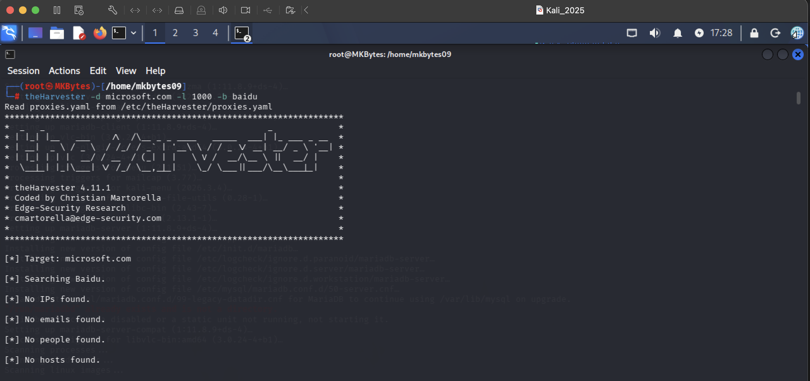
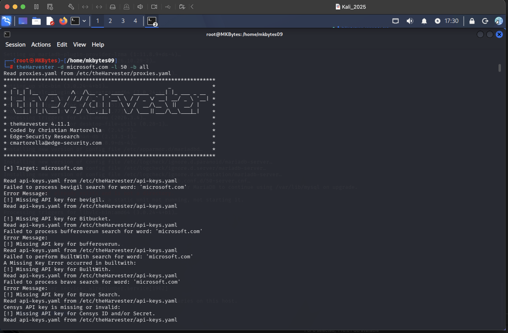

<div align="center">
  
**WEEK 2 | PROJECT MODULE 4**
  
# FOOTPRINTING WITH theHarvester

</div>

> **Target organization:** microsoft.com
> **Platform:** Kali Linux
> **Findings file:** `Findings-W2-M4.docx`
> **Author:** `Muhammad Kamil`
> **Date:** `12-11-2026`

---

## Table of Contents

1. [Reconnaissance Introduction](#1-reconnaissance-introduction)
2. [Task Objectives](#2-task-objectives)
3. [Deliverables](#3-deliverables)
4. [Tools Used](#4-tools-used)
5. [Tool Definition, Attacker Usage & Evidence](#5-tool-definition-attacker-usage--evidence)
   - [5.1 theHarvester – Definition](#51-theharvester--definition)
   - [5.2 How Attackers Use theHarvester](#52-how-attackers-use-theharvester)
   - [5.3 Task 1 – Baidu Source, Limit 1000](#53-task-1--baidu-source-limit-1000)
   - [5.4 Task 2 – All Sources, Limit 50](#54-task-2--all-sources-limit-50)
6. [Disclaimer](#6-disclaimer)
7. [Conclusion](#7-conclusion)
8. [References](#8-references)

---

## 1. Reconnaissance Introduction

**theHarvester** is a passive OSINT reconnaissance tool built into Kali Linux. It automates the process of querying multiple public data sources — search engines, DNS, certificate transparency logs, and other OSINT APIs — to collect **email addresses, subdomains, hostnames, open ports, and employee names** associated with a target domain. It was built specifically for the early, pre-engagement stage of a penetration test, to answer the question "how much of this organization's footprint is already public?" before any active scanning begins.

Because theHarvester queries **third-party data sources** (search engines, APIs) rather than the target's own infrastructure, this is a **passive** technique: the target organization sees no traffic from the tester at all. This module builds directly on Module 3 (Maltego), using a different, more specialized tool to cover the same category of data — public email addresses and subdomains — while also comparing how **source selection** and **result limits** change the completeness of the output.

This module is mapped to **MITRE ATT&CK Technique T1589.002 – Gather Victim Identity Information: Email Addresses** and **T1590.005 – Gather Victim Network Information: IP Addresses / DNS**.

---

## 2. Task Objectives

| # | Task | Source | Result Limit | Objective |
|---|------|--------|---------------|-----------|
| 1 | Find email IDs & subdomains for `microsoft.com` | Baidu | 1000 | Enumerate the footprint discoverable through a single, non-mainstream search engine source. |
| 2 | Find email IDs & subdomains for `microsoft.com` | All sources | 50 | Enumerate the footprint discoverable by aggregating every configured source, capped at a smaller result limit, and compare coverage against Task 1. |

---

## 3. Deliverables

- [x] This `README.md` report documenting the methodology, tool, and findings.
- [x] Screenshot evidence for each task, plus a findings document:

| # | Evidence Name | Description |
|---|----------------|--------------|
| 1 | `theHarvester-Result1` | Output of Task 1 (Baidu source, limit 1000). |
| 2 | `theHarvester-Result2` | Output of Task 2 (all sources, limit 50). |
| 3 | `Findings-W2-M4.docx` | Full compiled list of discovered email addresses and subdomains from both tasks. |

> **Handling note:** as with the Maltego module, the full lists of discovered emails/subdomains in `Findings-W2-M4.docx` are real organizational data. Keep that file in your private course submission; don't publish the full list to a public portfolio, GitHub repo, or social media. See [Section 6](#6-disclaimer).

---

## 4. Tools Used

| # | Tool | Category | Purpose | Type of Recon |
|---|------|----------|---------|----------------|
| 1 | **Kali Linux** | Operating System / Platform | Penetration-testing distribution used to run theHarvester. | – |
| 2 | **theHarvester** | OSINT / Email & Subdomain Enumeration | Aggregates public data sources to collect emails, subdomains, hosts, and related footprint data for a target domain. | Passive |

---

## 5. Tool Definition, Attacker Usage & Evidence

### 5.1 theHarvester – Definition

theHarvester is run from the command line with a target domain (`-d`), a data source or set of sources (`-b`), and a result limit (`-l`). It supports dozens of source modules, including search engines (Google, Bing, Baidu, Yahoo), certificate transparency logs (`crtsh`), DNS brute-forcing, and specialized OSINT APIs (Shodan, Hunter.io, SecurityTrails, when API keys are configured). Results are normalized and deduplicated into clean lists of emails, hosts/subdomains, and IPs.

**General command syntax:**
```bash
theHarvester -d <domain> -b <source> -l <limit>
theHarvester -d <domain> -b all -l <limit>
```

### 5.2 How Attackers Use theHarvester

- **Rapid attack-surface mapping:** a single command returns a consolidated list of subdomains, which attackers use to find forgotten, staging, or poorly secured hosts (e.g. `dev.`, `test.`, `vpn.`, `uat.`) that aren't linked from the main site and are easy to miss manually.
- **Email harvesting for phishing, at scale:** like Maltego, theHarvester's email results reveal naming conventions and real addresses that feed directly into phishing and password-spraying campaigns.
- **Source comparison for completeness:** different search engines and data sources index different parts of the internet. An attacker will often run multiple sources (as this module does with Baidu vs. "all") because a subdomain indexed by one search engine may be entirely missing from another — relying on a single source risks an incomplete picture of the target.
- **Pivoting into active recon:** subdomains discovered here become the direct input list for later active tools (port scanners, `whatweb`, vulnerability scanners from earlier modules), turning a passive list into a prioritized list of live targets to probe next.
- **Low cost, high value:** because theHarvester only queries third-party sources, an attacker gets a wide view of the target's exposure without sending a single packet to the target's own network — making this phase essentially risk-free and undetectable to the target.

### 5.3 Task 1 – Baidu Source, Limit 1000

**Command used:**
```bash
theHarvester -d microsoft.com -b baidu -l 1000
```

**Evidence – theHarvester-Result1:**



**Key observations:**
- Number of subdomains found: `<fill in>`
- Number of email addresses found: `<fill in>`
- Notable hosts discovered: `<fill in>`

---

### 5.4 Task 2 – All Sources, Limit 50

**Command used:**
```bash
theHarvester -d microsoft.com -b all -l 50
```

**Evidence – theHarvester-Result2:**




> **Comparing Task 1 and Task 2:** despite Task 1 allowing a much higher result limit (1000 vs. 50), aggregating **all sources** in Task 2 can surface subdomains and emails that a single source like Baidu never indexed, while Task 1's higher limit can pull deeper into one source's index than Task 2's capped, multi-source run does.

---

## 6. Disclaimer

This project was carried out **for educational purposes as part of an authorized training module**. Both tasks used only **passive** OSINT techniques: theHarvester queries third-party search engines and public data sources, never the target organization's own infrastructure directly, so no traffic was sent to Microsoft's systems at any point.

That said, the same caution applied to the Maltego module (Week 2, Module 3) applies here:

- The emails and subdomains returned are **real organizational data**, some of it tied to identifiable individuals. They must be handled responsibly and in line with this course's scope, not published in full or used for any purpose outside this educational exercise.
- This report and its findings must **never** be used to send phishing emails, probe discovered subdomains without separate authorization, or attempt access to any system found through this enumeration.
- Large organizations such as Microsoft often publish their own **responsible disclosure / bug bounty policies** that define what active testing (beyond this passive OSINT exercise) is permitted and by whom; this exercise does not fall under, or substitute for, such a program.

Unauthorized active testing of any discovered subdomain may violate computer-misuse laws (for example the Prevention of Electronic Crimes Act in Pakistan, the CFAA in the United States, or the Computer Misuse Act in the United Kingdom). The author accepts no responsibility for any misuse of the information or methodology contained in this document.

---

## 7. Conclusion

This module highlighted how much of an organization's footprint — email naming patterns, subdomains, and infrastructure hints — is sitting in public search-engine indexes, retrievable with a single command and zero direct contact with the target. Comparing a single-source run (Baidu, limit 1000) against an all-sources run (limit 50) also showed that **source breadth matters as much as result limit**: no single data source has complete coverage, so a thorough OSINT assessment should combine multiple sources rather than relying on one, however high its limit is set.

For defenders, the lesson mirrors Module 3's: minimize what's indexable in the first place. Deprecate and remove DNS records for unused subdomains, avoid publishing employee emails in a predictable, easily-guessable format, and monitor certificate transparency logs for unexpected subdomains being issued under the organization's name.

---

## 8. References

1. theHarvester – Official GitHub Repository: <https://github.com/laramies/theHarvester>
2. MITRE ATT&CK – Gather Victim Identity Information: Email Addresses (T1589.002): <https://attack.mitre.org/techniques/T1589/002/>
3. MITRE ATT&CK – Gather Victim Network Information (T1590): <https://attack.mitre.org/techniques/T1590/>
4. MITRE ATT&CK – Reconnaissance (TA0043): <https://attack.mitre.org/tactics/TA0043/>
5. OWASP Web Security Testing Guide – Information Gathering: <https://owasp.org/www-project-web-security-testing-guide/>
6. Kali Linux Tools – theHarvester: <https://www.kali.org/tools/theharvester/>
7. NIST SP 800-115 – Technical Guide to Information Security Testing and Assessment: <https://csrc.nist.gov/publications/detail/sp/800-115/final>
