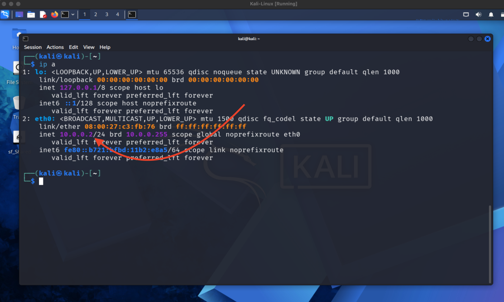
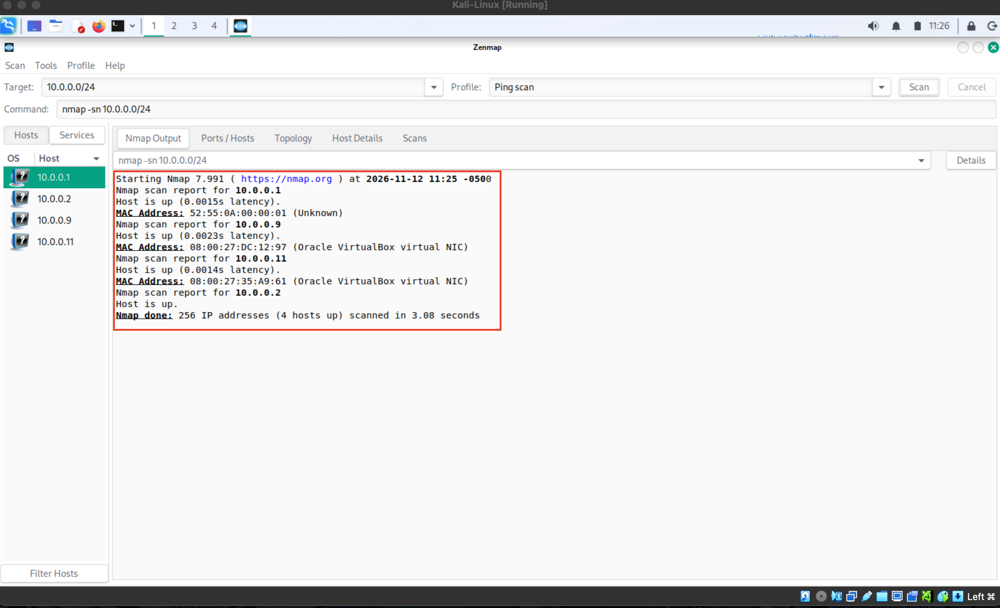
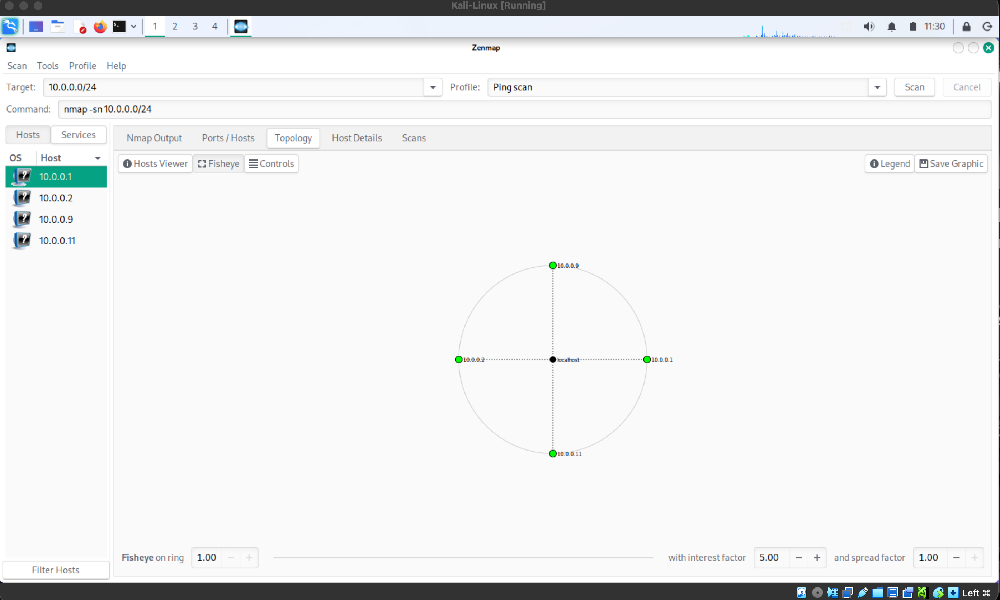

<div align="center">
  
**WEEK 2 | PROJECT MODULE 5**
  
# NETWORK SCANNING WITH ZENMAP

</div>

> **Target:** Local IP subnet `10.0.0.0/24` (own/lab network)
> **Platform:** Kali Linux / Zenmap (Nmap GUI)
> **Author:** `Muhammad Kamil`
> **Date:** `12-11-2026`

---

## Table of Contents

1. [Reconnaissance Introduction](#1-reconnaissance-introduction)
2. [Task Objectives](#2-task-objectives)
3. [Deliverables](#3-deliverables)
4. [Tools Used](#4-tools-used)
5. [Tool Definition, Attacker Usage & Evidence](#5-tool-definition-attacker-usage--evidence)
   - [5.1 Zenmap / Nmap – Definition](#51-zenmap--nmap--definition)
   - [5.2 How Attackers Use Network Scanning](#52-how-attackers-use-network-scanning)
   - [5.3 Task Results](#53-task-results)
6. [Disclaimer](#6-disclaimer)
7. [Conclusion](#7-conclusion)
8. [References](#8-references)

---

## 1. Reconnaissance Introduction

Where Modules 1–4 focused on **external, internet-facing** reconnaissance (domain, DNS, web technology, OSINT), this module shifts to **internal network scanning** — discovering what else is actually present on the local network segment. This is the step an attacker takes immediately after gaining a foothold inside a network (via phishing, a compromised VPN account, or physical access), and it's also a routine task for any network administrator mapping their own environment.

**Zenmap** is the official graphical front-end for **Nmap** ("Network Mapper"), the industry-standard tool for host discovery, port scanning, service/version detection, OS fingerprinting, and network topology visualization. Unlike the passive OSINT tools used in Modules 3 and 4, network scanning is an **active** technique: it sends packets directly to hosts on the target network and observes their responses.

This module is mapped to **MITRE ATT&CK Technique T1018 – Remote System Discovery** and **T1046 – Network Service Discovery**.

---

## 2. Task Objectives

| # | Task | Objective |
|---|------|-----------|
| 1 | Find the list of live hosts/PCs in the local IP subnet | Perform host discovery across `10.0.0.0/24` to identify every active device on the segment. |
| 2 | Determine how many hosts are live | Count the total number of responsive hosts found. |
| 3 | Identify the IP addresses of the live hosts | Record each live host's IPv4 address. |
| 4 | Identify the MAC addresses of the live hosts | Record each live host's MAC address (Layer 2 identifier), where available. |
| 5 | Display and save the output topology in PDF format | Use Zenmap's Topology view to visualize the network layout and export it as a PDF. |

---

## 3. Deliverables

- [x] This `README.md` report documenting the methodology, tool, and findings.
- [x] Screenshot and file evidence for each stage of the task:

| # | Evidence Name | Description |
|---|----------------|--------------|
| 1 | `Local-Network-Details` | Local network/interface configuration used to determine the subnet to scan. |
| 2 | `Live-Hosts` | Zenmap host-discovery results listing all live hosts on the subnet. |
| 3 | `Topology-Graph` | Zenmap's Topology tab, showing the visual network map. |
| 4 | `Topology-Graphics.pdf` | Exported PDF of the topology graphic, saved to the desktop. |

- [x] Answers to the four scan questions (hosts count, IPs, MACs, topology export).
- [x] Tool definition explained from an attacker's perspective.
- [x] Disclaimer, conclusion and references.

---

## 4. Tools Used

| # | Tool | Category | Purpose | Type of Recon |
|---|------|----------|---------|----------------|
| 1 | **Kali Linux** | Operating System / Platform | Penetration-testing distribution used to run Zenmap. | – |
| 2 | **Zenmap** | Network Scanning (GUI) | Graphical front-end for Nmap; runs scans via selectable profiles and visualizes results (hosts, ports, services, topology). | Active |
| 3 | **Nmap** | Network Scanning (Engine) | Underlying scan engine Zenmap drives; performs host discovery, port scanning, and OS/service fingerprinting. | Active |

---

## 5. Tool Definition, Attacker Usage & Evidence

### 5.1 Zenmap / Nmap – Definition

Nmap works by sending specially-crafted packets (ICMP echo requests, ARP requests, TCP/UDP probes) to target hosts and analyzing the responses to determine which hosts are up, which ports are open, what services are running, and often what operating system a host is likely running. Zenmap wraps this in a GUI with pre-built **scan profiles** (e.g. "Ping scan," "Quick scan," "Intense scan"), a results browser (Hosts, Services, Nmap Output, Ports/Hosts, Host Details tabs), and a **Topology** tab that renders discovered hosts and the paths between them as an interactive bubble diagram.

For hosts on the **same local subnet** as the scanning machine, Nmap defaults to **ARP-based host discovery**, which is why MAC addresses are reliably returned for local hosts — ARP operates at Layer 2 and always reveals the physical (MAC) address of a device on the same network segment, something that isn't possible when scanning hosts across the internet.

### 5.2 How Attackers Use Network Scanning

- **Internal reconnaissance after a foothold:** once an attacker has any access inside a network (a phished workstation, a compromised IoT device, a rogue access point), a subnet scan is almost always their first move — it answers "what else is on this network, and what can I reach from here?"
- **Live host enumeration:** knowing exactly which IPs are active narrows a huge address space (e.g. a /24 with 254 possible addresses) down to a short, actionable target list, saving time compared to probing every address individually.
- **MAC address / vendor identification:** the first three octets of a MAC address (the OUI) identify the hardware vendor, letting an attacker infer device types (e.g. a VM hypervisor's virtual NIC vendor, a specific router manufacturer, an IP camera vendor), which helps prioritize targets and select relevant exploits.
- **Topology mapping for lateral movement:** the Topology view highlights gateways, routers, and multi-homed hosts, helping an attacker understand network segmentation and identify pivot points to reach otherwise isolated subnets.
- **Pre-exploitation targeting:** once live hosts are known, the natural next step (not performed in this module) is a deeper scan of each host for open ports and service versions, which is how a specific exploit gets matched to a specific target.

### 5.3 Task Results

**Command used (host discovery / ping scan):**
```bash
nmap -sn 10.0.0.0/24
```

**Command used (topology / full scan, equivalent to Zenmap's "Intense scan" profile):**
```bash
nmap -T4 -A -v 10.0.0.0/24
```

**Evidence – Local-Network-Details:**



Local interface/subnet configuration confirming the `10.0.0.0/24` range to scan.

**Evidence – Live-Hosts:**



| Question | Answer |
|----------|--------|
| How many hosts are live in the subnet? | **4** |
| IP addresses of live hosts | **10.0.0.1, 10.0.0.2, 10.0.0.9, 10.0.0.11** |
| MAC addresses of live hosts | **52:55:0A:00:00:01, 08:00:27:DC:12:97, 08:00:27:35:A9:61** |

> **Observation:** only three MAC addresses are listed for four live hosts. This is expected Nmap/Zenmap behavior — the scanning machine's own IP (one of the four live hosts) does not return a MAC address to itself, since ARP resolution only applies to *other* devices on the segment. 

**Evidence – Topology-Graph:**



Zenmap's Topology tab, visualizing the four live hosts and their relationship on the subnet as an interactive node graph.

**Evidence – Topology-Graphics.pdf:**

The topology graphic was exported and saved to the desktop as [`Topology-Graphics.pdf`](./Evidences-W2-M5/Topology-Graphics.pdf), via Zenmap's **Topology → Save Graphic** option.

---

## 6. Disclaimer

This project was carried out **for educational purposes as part of an authorized training module**, scanning only the author's own local/lab subnet (`10.0.0.0/24`). Active network scanning — even simple host discovery — must only ever be performed against networks you own, administer, or have **explicit written permission** to test. Scanning a network without authorization, including a employer's, a neighbor's, or a public Wi-Fi network you don't control, may violate computer-misuse laws (for example the Prevention of Electronic Crimes Act in Pakistan, the CFAA in the United States, or the Computer Misuse Act in the United Kingdom), regardless of whether any vulnerability was actually exploited.

Even for a personal/lab network, it's good practice to avoid publishing a full internal network layout (IP addresses, MAC addresses, device topology) in a public portfolio or social media post, since it reveals details about a real, currently-running network that could otherwise be kept private. Keep the detailed scan evidence in your private course submission, and discuss the exercise at a conceptual level if sharing publicly.

The author accepts no responsibility for any misuse of the information or methodology contained in this document.

---

## 7. Conclusion

This module moved from external, internet-facing footprinting into **internal network discovery**, the phase an attacker relies on immediately after gaining any foothold on a network. Using Zenmap's GUI over raw Nmap made the workflow approachable: a single ping scan identified every live host on the subnet, and the Topology view turned a flat list of IPs and MACs into a visual map of how those hosts relate to one another.

The key defensive lesson is that **a flat, unsegmented network gives an attacker maximum reach from a single compromised device**. Network segmentation (VLANs, firewall rules between segments), disabling ICMP/ARP responses where not needed, and monitoring for unexpected scan traffic (which most intrusion-detection systems can flag) are the practical controls that limit what this kind of reconnaissance can reveal to an attacker who shouldn't be on the network at all.

**Summary of findings:** Four live hosts were identified on the `10.0.0.0/24` subnet (10.0.0.1, 10.0.0.2, 10.0.0.9, 10.0.0.11), three of which resolved to distinct MAC addresses via ARP. The network topology was visualized and exported as `Topology-Graphics.pdf` for reference.
---

## 8. References

1. Nmap – Official Documentation: <https://nmap.org/book/man.html>
2. Zenmap – Official Documentation: <https://nmap.org/book/zenmap.html>
3. MITRE ATT&CK – Remote System Discovery (T1018): <https://attack.mitre.org/techniques/T1018/>
4. MITRE ATT&CK – Network Service Discovery (T1046): <https://attack.mitre.org/techniques/T1046/>
5. MITRE ATT&CK – Reconnaissance (TA0043): <https://attack.mitre.org/tactics/TA0043/>
6. Kali Linux Tools – Nmap: <https://www.kali.org/tools/nmap/>
7. IEEE – MAC Address / OUI Lookup Registry: <https://standards-oui.ieee.org/>
8. NIST SP 800-115 – Technical Guide to Information Security Testing and Assessment: <https://csrc.nist.gov/publications/detail/sp/800-115/final>
