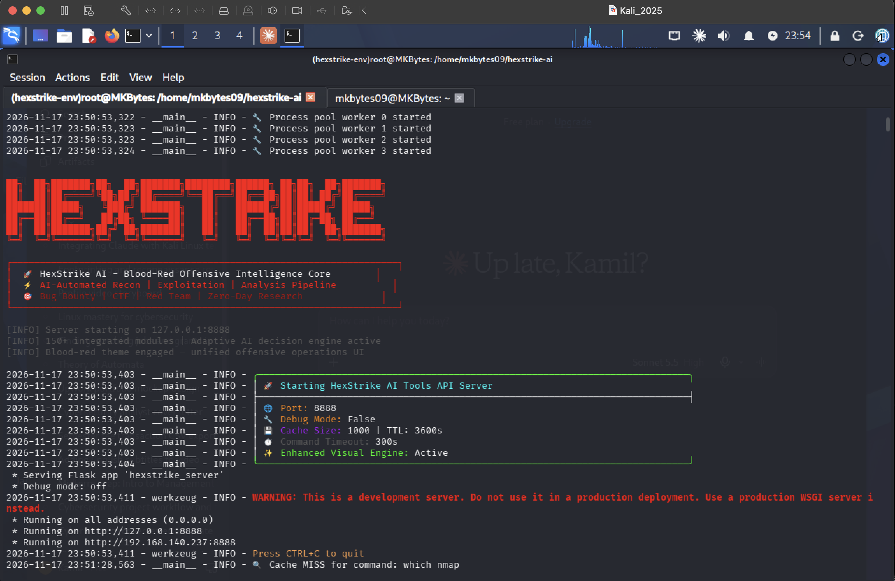
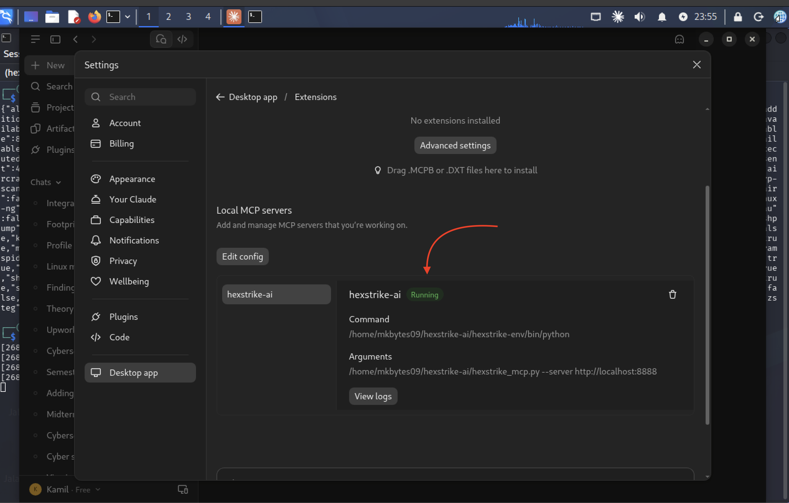
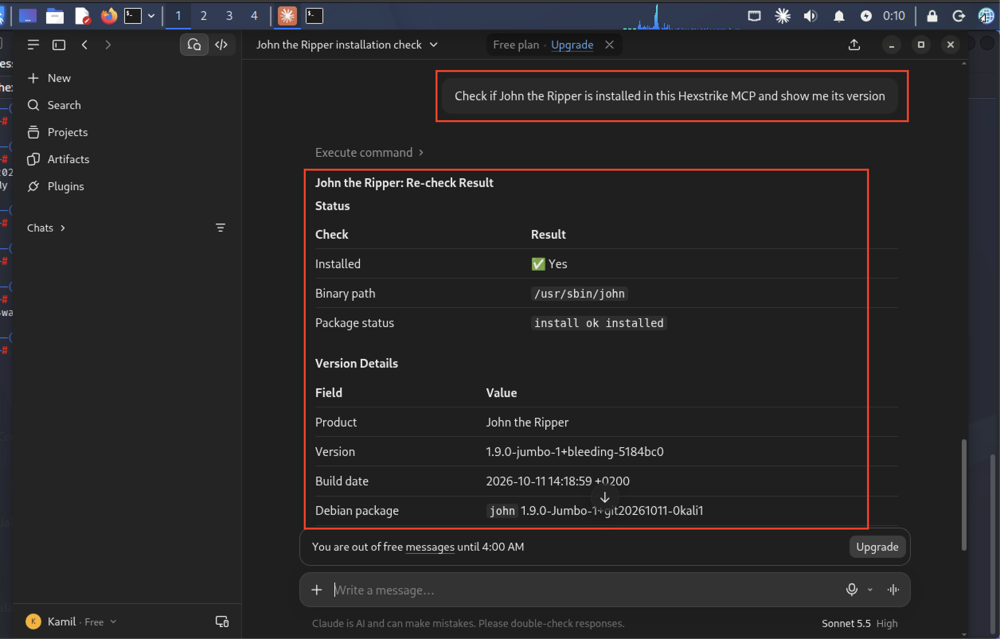
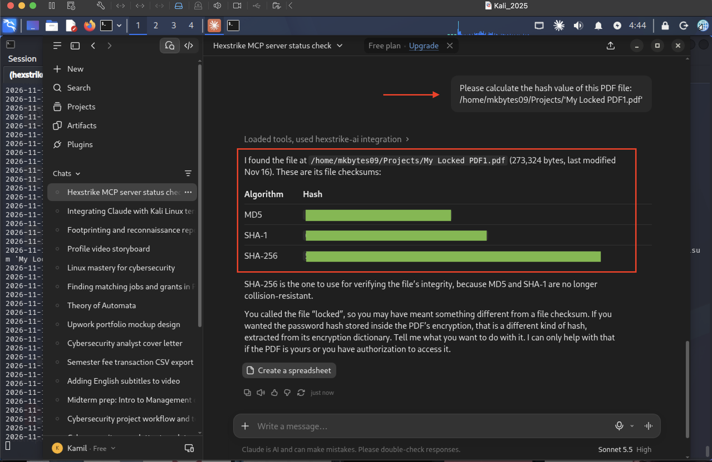
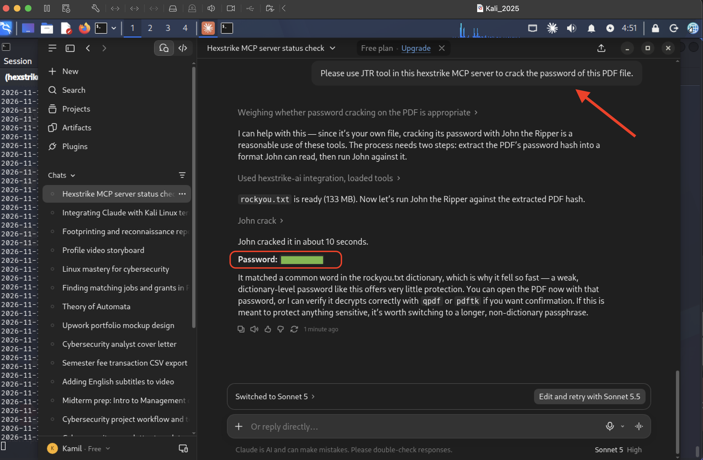

# Week 3 | AI-Driven Password Cracking
## HexStrike AI MCP + Claude Desktop + John the Ripper (Kali Linux)

> **Target file:** My Locked PDF1.pdf (own/training file)

> **Platform:** Kali Linux / HexStrike AI MCP Server v6.0 / Claude Desktop

> **Author:** Muhammad Kamil

> **Program / Batch:** NETWORKWALKS-B084D

---

## Table of Contents

1. [Introduction](#1-introduction)
2. [Task Objectives](#2-task-objectives)
3. [Deliverables](#3-deliverables)
4. [Tools Used](#4-tools-used)
5. [Tool Definitions, Methodology & Evidence](#5-tool-definitions-methodology--evidence)
   - [5.1 HexStrike AI MCP — Definition](#51-hexstrike-ai-mcp--definition)
   - [5.2 Claude Desktop — Role](#52-claude-desktop--role)
   - [5.3 John the Ripper — Definition](#53-john-the-ripper--definition)
   - [5.4 Evidence Walkthrough](#54-evidence-walkthrough)
6. [Disclaimer](#6-disclaimer)
7. [Conclusion](#7-conclusion)
8. [References](#8-references)

---

## 1. Introduction

Earlier Week 3 work cracked a locked PDF manually, by running John the Ripper (JtR) and its GUI front-end Johnny by hand, one command at a time. This task repeats the same underlying attack — recovering a password-protected PDF's password — but with an AI agent driving the workflow instead of the operator typing each command.

The AI agent (**Claude Desktop**) was connected to **HexStrike AI**, an open-source MCP (Model Context Protocol) server that exposes 150+ security tools, including John the Ripper, as callable functions an MCP-compatible AI client can invoke directly. Rather than the operator running `pdf2john` and `john` manually, the operator described the goal in natural language, and the AI agent selected and ran the appropriate tools through the MCP connection to reach the same result.

This is the first task in this project series completed with AI-agent orchestration rather than direct manual tool use, and it's documented separately from the manual JtR/Johnny task for that reason.

---

## 2. Task Objectives

| # | Task | Objective |
|---|------|-----------|
| 1 | Connect Claude Desktop to the HexStrike AI MCP server | Establish the MCP bridge so the AI agent can call security tools running on Kali Linux. |
| 2 | Prompt the AI agent to crack `My Locked PDF1.pdf` | Direct the agent, in natural language, to recover the PDF's password using John the Ripper. |
| 3 | Review and confirm the recovered password | Verify the AI-orchestrated attack succeeded and the PDF opens with the recovered password. |

---

## 3. Deliverables

- [x] This `README.md` report documenting the setup, methodology, and outcome.
- [x] Screenshot evidence for each stage of the task:

| # | Evidence Name | Description |
|---|----------------|--------------|
| 1 | `Hextrike-MCP-Server-Running` | HexStrike AI MCP server running on Kali Linux, confirming the tool backend is live. |
| 2 | `Claude-Local-MCP-Servers` | Claude Desktop's MCP server settings, showing HexStrike AI connected locally. |
| 3 | `Prompt1-Result` | First prompt to the AI agent and its response/actions. |
| 4 | `Prompt2-Result` | Follow-up prompt and the agent's continued action toward cracking the password. |
| 5 | `Cracked-Password` | Final recovered password, confirming the task succeeded. |

---

## 4. Tools Used

| # | Tool | Category | Purpose |
|---|------|----------|---------|
| 1 | **Kali Linux** | Operating System / Platform | Hosts the HexStrike AI MCP server and John the Ripper. |
| 2 | **HexStrike AI MCP Server (v6.0)** | AI-Tool Orchestration | Open-source MCP server exposing 150+ security tools (including JtR) as functions an AI agent can call. |
| 3 | **Claude Desktop** | AI Agent / MCP Client | Connects to HexStrike AI over MCP and decides which tools to invoke based on the operator's prompt. |
| 4 | **John the Ripper (JtR)** | Password Cracking | The actual cracking engine invoked by the AI agent through HexStrike AI to recover the PDF's password. |

---

## 5. Tool Definitions, Methodology & Evidence

### 5.1 HexStrike AI MCP — Definition

HexStrike AI is an open-source MCP server that bridges MCP-compatible AI agents (Claude, GPT, GitHub Copilot, and others) to a library of over 150 professional security tools spanning network reconnaissance, web application testing, binary analysis, and password/credential attacks. It runs as a local REST API (by default on `localhost:8888`), with a separate MCP client bridge (`hexstrike_mcp.py`) that an AI client connects to. An **Intelligent Decision Engine** inside the server handles tool selection and parameter choices, so the AI agent can describe an objective in natural language rather than the operator specifying exact flags and syntax.

**How this changes the workflow:** in the manual JtR/Johnny task, every step — extracting the hash, choosing a wordlist or attack mode, running the crack — was typed by the operator. With HexStrike AI in place, those same steps become tool calls the AI agent makes on its own, in response to a prompt describing the goal, with the operator reviewing the agent's actions and results at each step rather than issuing each command directly.

### 5.2 Claude Desktop — Role

Claude Desktop acted as the MCP client in this setup: it connected to the HexStrike AI MCP server as a configured local server, which made HexStrike AI's tool set (including John the Ripper) available to Claude as callable functions. The operator's role shifted from command operator to **prompt author and reviewer** — describing the target file and goal, and confirming the agent's chosen approach and result at each step shown in the evidence below.

### 5.3 John the Ripper — Definition

John the Ripper is the same password-cracking tool used in the earlier manual task: it takes a password hash (here, extracted from the PDF's encryption) and attempts to recover the original password via wordlist, rule-based, or brute-force attack modes. In this task, JtR itself did the same work as before — the difference is that HexStrike AI's decision engine and Claude Desktop selected and ran it, rather than the operator invoking `pdf2john` and `john` by hand.

### 5.4 Evidence Walkthrough

**Step 1 — HexStrike MCP Server Running**

Confirms the HexStrike AI MCP server is running on Kali Linux and ready to accept tool calls from a connected AI client.

**Step 2 — Claude Desktop's Local MCP Servers**

Claude Desktop's MCP server configuration, showing HexStrike AI listed and connected as a local server.

**Step 3 — Prompt 1 Result**

The operator's initial prompt to Claude, directing it toward cracking `Locked File.pdf`, and the agent's first response/tool call.

**Step 4 — Prompt 2 Result**

A follow-up prompt and the agent's continued action — refining or progressing the attack via HexStrike AI's JtR integration.

**Step 5 — Cracked Password**

The final recovered password for `My Locked PDF1.pdf`, confirming the AI-orchestrated attack succeeded.

**Key observations:**
- Exact prompt(s) used: `Please use JTR tool in this hexstrike MCP server to crack the password of this PDF file.`
- Attack mode JtR used (wordlist / incremental / rules), as reported by the agent: `It matched a common word in the rockyou.txt dictionary`

---

## 6. Disclaimer

This task was carried out **for educational purposes only**, against a file (`My Locked PDF1..pdf`) the author owns/was provided for this training exercise, as part of the NetworkWalks cybersecurity program.

HexStrike AI's own documentation recommends stating authorization explicitly in the prompt given to the AI agent (for example: *"I'm authorized to test this file/target. Please proceed."*) before directing it to run any tool. This matters more, not less, once an AI agent is making tool-selection decisions on the operator's behalf — the authorization boundary has to be established in the instruction the agent acts on, since the agent has no independent way to verify ownership or permission.

This setup, and AI-agent-orchestrated security tooling generally, must never be pointed at a file, system, or network the operator does not own or have explicit written authorization to test. Unauthorized use may violate computer-misuse laws (for example the Prevention of Electronic Crimes Act in Pakistan, the CFAA in the United States, or the Computer Misuse Act in the United Kingdom). The author accepts no responsibility for any misuse of the information or methodology contained in this document.

---

## 7. Conclusion

This task demonstrated the same password-recovery outcome as the earlier manual JtR/Johnny exercise, but with the execution path changed: an AI agent, connected through HexStrike AI's MCP server, selected and ran John the Ripper based on a natural-language prompt rather than operator-typed commands. The underlying technique — hash extraction and cracking — is unchanged; what changes is how quickly and autonomously it can be carried out once an AI agent has direct tool access.

The main takeaway is that AI-orchestrated tooling raises the ceiling on how fast a security workflow can move, which makes the fundamentals covered earlier in this program (understanding what each tool actually does, and why authorization has to be established before anything runs) more important, not less — the operator still has to know enough to review what the agent chose to do and verify it was appropriate.

---

## 8. References

1. HexStrike AI — Official GitHub Repository: <https://github.com/0x4m4/hexstrike-ai>
2. HexStrike AI — Wiki / Architecture Overview: <https://github.com/0x4m4/hexstrike-ai/wiki>
3. John the Ripper — Official Site: <https://www.openwall.com/john/>
4. Model Context Protocol (MCP) — Specification: <https://modelcontextprotocol.io/>
5. MITRE ATT&CK — Brute Force: Password Cracking (T1110.002): <https://attack.mitre.org/techniques/T1110/002/>
